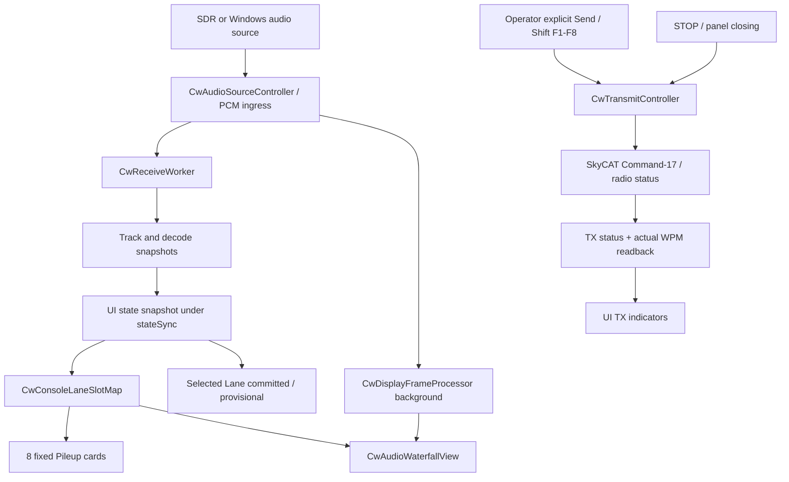

# SkyRoof CW Console V2 — P0 设计与交互契约

> 基线：SkyRoof-Plus v1.74，`master` = `b99286259e0e9e94f2956ec604409cb92bd7f0eb`（2026-11-14 核对）  
> 范围：WinForms / DockPanelSuite CW Console；只冻结界面、状态和交互契约，P0 不修改 CW RX/TX 处理链路。  
> 后续阶段：P1 `feature/cw-v2-layout` → P2 `feature/cw-v2-integration` → P3 `feature/cw-v2-operations` → P4 `feature/cw-v2-validation`。各阶段独立 PR，按序合入。

## 1. 源码核对与既有能力

| 领域 | 当前实现 / 代码入口 | V2 处理 |
| --- | --- | --- |
| UI 生命周期 | `SkyRoof/Panels/CwConsolePanel.cs`：`BuildUi`、`FormClosing`、`RefreshUi` | 拆分构建函数，不迁移后台资源到 UI |
| 音频 | `CwAudioSourceController`、`CwConsoleSettings` | 保留 SDR / Windows Capture / RS-BA1 Loopback 源及具体端点设置 |
| 模型切换 | `CwReceiveWorker.SetDecoderMode`；`DecoderModeBtn_Click` | DeepCW / New CW 互斥，不重建音频/TX |
| 显示清理 | `CwDenoiseMode`；`CwDisplayFrameProcessor` | Raw / HamNoise Classic / HamNoise V2 仅改变显示，不污染解码 PCM |
| 频谱与瀑布 | `CwAudioWaterfallView`；`CwAudioWaterfallAnalyzer` | AF 纵轴（高频在上），时间横向右移，独立平移/缩放 |
| 槽位 | `CwConsoleLaneSlotMap`、`CwPileupLaneList` | 固定 8 行；使用 H（Association Hint）优先，T（Track ID）回退；4 s grace |
| 解码详情 | `CwSelectedLaneView`、`CwTranscriptSnapshot` | 完整 Committed / Provisional，暂定文本区别着色；按稳定 identity 绑定 |
| 历史 | `ShowRxHistory`、`CwTranscriptArchive` | 保留历史与复制 |
| TX | `CwTransmitController`、`CwKeyerClient` | 继续委托 Command-17 / SkyCAT、BK-IN / 频率协调、watchdog；UI 不持有 TCP/CAT |
| 宏 | `CwMacroBank`、`CwMessageTiming` | F1–F8 装载，Shift+F1–F8 明确发送，右键编辑 |
| DPI/主题 | `UniformControlScale`、`Theme`、`GitHubThemeColors` | 复用 v1.74 Dock/Popup 缩放，禁止双重缩放/按宽度自动重排 |

### 已确认的关键实现细节

- `UiTimer` 为 250 ms 的状态/槽位轮询。音频接受与异步帧完成事件触发 waterfall pump，另有 100 ms fallback；瀑布刷新不应退化为 UI 计时器直接跑 FFT 或 HamNoise。
- `Worker_DecodeUpdated` 已丢弃旧解码引擎的迟到结果；timeline generation 变化会清除运行中的轨迹/文字/选中身份。主题或 Dock 改变 **不得** 触发 generation reset。
- `CwPileupLaneCard` 当前展示的是 local-floor **peak-over-floor**，不是经过校准的解码 SNR。V2 标签使用 `peak`，不可误标为 `SNR`。
- `CwSelectedLaneView` 避免在文字未变时重写 RichTextBox，以减少 250 ms 刷新对选择/光标/滚动位置的影响；V2 保持相同原则。
- `STOP` 可以取消等待中的异步 Send preflight，并经 `DisarmAsync` 停止；窗体关闭遵循异步 STOP/disarm 验证及未确认提示，不应改成同步阻塞。
- `WPM` 设置后读取 `CwKeyerStatus.Wpm` 回显；本地输入不能冒充电台已接受状态。

## 2. 控件树（P1 目标）

```text
CwConsolePanel : DockContent  [CW resource-free view]
└─ Root : TableLayoutPanel (5 rows; 1 column; no responsive reflow)
   ├─ Header : compact status & controls
   │  ├─ RX Toggle │ DecoderMode │ Source │ DisplayMode │ Settings │ History
   │  └─ RX/Model/Source/Worker state │ actual TX state │ WPM readback
   ├─ SkimmerWorkspace : SplitContainer 65% / 35%
   │  ├─ SpectrumArea
   │  │  ├─ CwAudioWaterfallView (AF vertical / time horizontal)
   │  │  ├─ AF PanBar
   │  │  └─ Zoom / AF viewport readout
   │  └─ PileupPane
   │     ├─ Header (CW verified x/8)
   │     └─ Slot 1 ... Slot 8 (fixed index)
   │        └─ AF │ peak │ drift │ H/T identity │ state │ short RX text │ Copy
   ├─ SelectedLane
   │  └─ selected identity/status │ full committed/provisional text │ Copy
   └─ TxComposer : fixed action area
      ├─ TX state / real WPM / BK-IN / watchdog
      ├─ Composer text input + length feedback
      ├─ Send │ STOP │ WPM set/readback
      └─ F1 ... F8 (load/preview/edit/Shift-send)
```

Header can internally have two compact lines; the five-region layout above defines **responsibility** rather than mandating a single WinForms row per visual element. Controls are retained/reparented once, not reconstructed on every 250 ms tick. STOP must remain visible and usable in normal Dock sizes; only extreme Dock width/height may use local scrolling.

### Size budget and DPI

At 1280×800 at 100% DPI, reserve ≥ 8×34 px + 22 px header for Pileup viewport, leaving Selected Lane and TX fixed action area visible. The preferred workspace ratio is 65:35 (current split default 68:32); use existing root minimums and v1.74 uniform Dock scaling, not adaptive field reordering. Test simulated 96/120/144/192 DPI (100/125/150/200%), compact floating, narrow dock, undock/redock, light/GitHub Dark and preexisting themes. At very small physical Dock size permit local overflow; never silently cover STOP. The 200%/800-pixel physical-height case can scroll only when it cannot meet readable row minimums.

## 3. 状态与事件数据流



**刷新原则：** DSP → immutable snapshots → 仅 UI 线程绑定控件。相同文本/颜色/状态不重复赋值；保留最后有效绘制帧和渲染缓存，主题切换/暂停布局不主动 `Clear()` 瀑布；事件队列不无限增长。8 张卡片实例及其位置在 UI 生命周期内固定。

## 4. 操作契约（必须保持唯一语义）

| 操作 | 执行 | 不得执行 |
| --- | --- | --- |
| 单击槽位 / 瀑布轨迹 | 选择 H/T identity、同步高亮及详情 | 修改 VFO、RIT/XIT、启动 TX |
| `HOLD`（P3） | 只固定**槽位身份占用**，使轨迹暂失时不被替换；显示 grace/stale | 伪造轨迹继续存在、停止跟踪器全局算法 |
| `RELEASE`（P3） | 解除该槽位身份占用，恢复正常回收策略 | 删除 CW History |
| `Tune RX`（P3 有条件） | 明确动作，先有 CW/CW-R + 侧带 + AF/RF + 多普勒的校验映射，再交 CAT | 普通槽位点击隐式改频 |
| `Use Callsign`（P3） | 只从**已确认**文本提取候选，人工点选并插入 TX 输入 | 自动发送；从 Provisional 直接推断可信呼号 |
| `Clear RX Text`（P3） | 清空显示文字范围，明确 archive 是否保留 | 清空当前 CAT/TX |
| `Clear Tracks`（P3） | 请求接收跟踪器重置轨迹代际，保留已归档历史 | 清除硬件状态 |
| `Reset View`（P3） | 恢复频谱 pan/zoom 等纯视图状态 | 重启音频设备、重置解码器 |
| `F1–F8` | 装载配置到编辑框 | 发送 |
| `Shift+F1–F8`、`Send` | 明确发送 + 现有 SkyCAT TX preflight | 自动改变 TX 频率 |
| `STOP` | 取消待发请求，停止/解除 keyer session；错误时明确未确认状态 | 仅隐藏 TX 指示并假定停发 |
| WPM | 写入并查询电台回读 | 将尚未确认的本地值显示为实际值 |
| DeepCW/New CW | 互斥切换 CW 接收解码器，并清掉旧引擎临时 UI 结果 | 重启音频/触发 TX |
| HamNoise | 只改变 waterfall/spectrum 显示输入 | 处理解码用 PCM |

主界面拥有 RIT/XIT 与卫星频率/多普勒联动；CW Console 只能通过明确定义且可核验的 `Tune RX` 意图请求调谐。不要新增第二套 RIT/XIT 或私有 CAT 连接。

### 状态指示规范

- RX：Off / Waiting / Running / Error，来自音频控制器状态。
- Decode：DeepCW Ready/Install needed/Error 或 New CW Built-in；区分 `InferenceBusy` 与当前引擎。
- Pileup：Active / Grace / Ambiguous / Provisional / Committed；显示 peak 和漂移 Hz/s；Confidence 来自已有身份模型，不虚构 SNR。
- TX：Idle / Preflight / Ready / Sending / Stop requested / Stop unverified / Error（状态不得比协议/控制器实际观测更乐观）。
- STOP 只由 TX 控制器能力与任务状态决定；不引入不必要的额外功能门禁。watchdog 倒计时是预计停止边界，不等于实机逐字符进度。

## 5. 主题令牌

不独立实现新的主题注册器；优先从现有 `Theme`、`GitHubThemeColors` 与 WinForms SystemColors 派生语义令牌：

| Token | 浅色 | GitHub Dark | 作用 |
| --- | --- | --- | --- |
| Surface | 浅灰 | 深灰 | 整体底色 |
| Card | 白 / Surface raised | 深色 raised | Pileup / Selected |
| Text | 高对比前景 | 高对比前景 | 主文案 |
| Subtle | 次要前景 | 次要前景 | 辅助 AF/peak |
| Active | 低饱和蓝 | 低饱和蓝 | Selected identity / focus |
| Warning | 琥珀 | 琥珀 | Grace / Ambiguous |
| Provisional | 暖色辅助 | 暖色辅助 | 暂定解码 |
| TX danger | 高对比红 | 高对比红 | STOP / sending |
| Waterfall | 保持深色高对比 | 保持深色高对比 | 实时频谱，不随卡片背景变白 |

必须覆盖 Hover、Focus、Disabled、Selected、Error。颜色之外还须有文字/状态区别；不能仅以红绿区分发送状态。

## 6. 实施边界与回归清单

### P1 布局（纯视觉）
重构 `BuildUi` / 传输区组装、卡片和 Selected Lane 的颜色/间距；不修改 `CwReceiveWorker`、`CwTransmitController`、`CwKeyerClient` 和 CAT 协议；重点回归 8 行同时显示、滚动/选中稳定、输入焦点与重绘缓存。

### P2 全功能接入
以旧控件事件链路逐项核对音频源、引擎、模型安装、显示模式、History、WPM、宏和 TX/STOP；不复制已有状态查询，不改变 Settings JSON 的已有字段/含义。

### P3 明确增强
优先 HOLD/RELEASE、Use Callsign、文字/轨迹/视图清理范围及状态提示；只有 CW/CW-R AF↔RF 映射和多普勒事务得到可验证实现时才加入 Tune RX。未定义队列、自动回复、逐字符发射进度不纳入。

### P4 发布验收
Windows Release、xUnit、docs validation、aislop，Windows UI 模拟 DPI/主题截图；Recorded WAV corpus 1/3/5/8 路与 5/10/15/25/40 Hz、QSB/漂移/强弱台对照，以 CER/WER/完整呼号率/ID switch 衡量。CI 无录音时如实记录 skipped，不将模拟 SkyCAT 或截图等同 IC-9700 实机。未经通过验收不创建发布 Release。

## 7. P0 验收结果与剩余风险

- 已核对：当前 UI 的音频/解码/渲染与发送职责、已有槽位身份与 grace、TX 异步取消、宏、WPM 状态读回、关闭清理机制。
- P0 为文档变更：没有修改行为、协议、依赖或测试期望；建议由 docs validation 检查格式与链接。
- P1 开始前需重点验证：顶栏每 250 ms 的值更新是否破坏编辑框焦点、是否产生重复布局；主题变更时的 RichTextBox 前景/Provisional 着色；系统 DPI 与 v1.74 UniformControlScale 的幂等处理；STOP 的固定可见性。
- 未验证：本机 Windows 真实 DPI 截图、真实 IC-9700/SkyCAT，以及硬件 Pileup 录音。本文件不将这些标记为通过。
